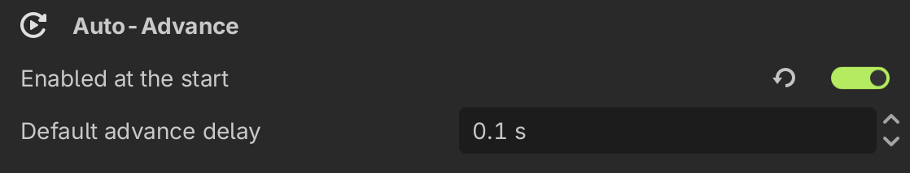
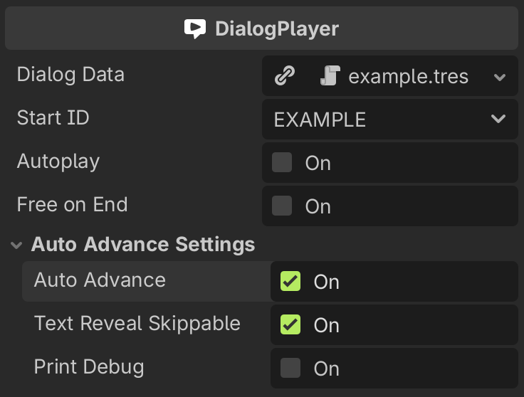

# Auto-Advance

The auto-advance feature allows the dialogues to **progress automatically to the next dialog or event after a configured delay**, without requiring the player to press the continue input. This is useful, for example, to create **cinematic scenes**, **kiosk-style demos**, or dialogues that advance on their own while the player just reads them.

## How auto-advance works?

---

When the current dialog finishes displaying (either when the typing animation is completed or when the text is skipped), if the auto-advance is enabled, the [DialogBox](../class-reference/nodes/dialog-box.md) **waits the configured delay** and then automatically continues to the next dialog or event of the dialogue tree.

Some considerations about the behavior:

- The auto-advance is **not applied while dialogue options are being displayed**, so the player must always select an option when a dialog requires it.
- The pending delay is **cancelled** if the auto-advance is disabled or the dialogue stops running while waiting, so the player will stay on the current dialog or continue manually.

## Auto-Advance settings

---



The plugin provides two settings for this feature in the [Auto-Advance settings section](../settings#auto-advance):

- `Enabled at the start`: If enabled, the [DialogPlayer](../class-reference/nodes/dialog-player.md) nodes **start with auto-advance enabled**, even if the `auto_advance` property is set to `false` in the inspector.
- `Default advance delay`: The default time **in seconds to wait** before advancing to the next dialog/event when no other delay is given.

## Using auto-advance in the DialogPlayer

---



The [DialogPlayer](../class-reference/nodes/dialog-player.md) node exposes the `auto_advance` and `text_reveal_skippable` properties, available in the `Auto Advance Settings` inspector group of your DialogPlayers:

- **Auto Advance** (`auto_advance`): Enables or disables the auto-advance for all the dialogs of the player. _It is disabled by default, so the player will wait for the user to press the continue input between dialogs._
- **Allow Skip Text Reveal** (`text_reveal_skippable`): Lets the player skip the typing animation while it is enabled (see the [relation with the no-skip tag](#relation-with-the-no-skip-tag) below).

You can also set the `auto_advance` property from code:

```gdscript title="main.gd" showLineNumbers
func _ready() -> void:
	var dialog_player : DialogPlayer = $DialogPlayer
	dialog_player.auto_advance = true
	dialog_player.play()
```

> _Note that the **Enabled at the start** setting takes precedence over this property: if it is enabled in the plugin settings, the DialogPlayer will start with auto-advance enabled regardless of the `auto_advance` value set in the inspector._

You can also configure the auto-advance of a [DialogBox](../class-reference/nodes/dialog-box.md) node directly using the [set_auto_advance](../class-reference/nodes/dialog-box#set-auto-advance-method)() method, which receives whether the auto-advance is `enabled` and an optional `delay` in seconds (missing delay defaults to the **Default advance delay** setting):

```gdscript title="custom_dialog_box.gd" showLineNumbers
func _ready() -> void:
	# Advance automatically after 1.5 seconds
	set_auto_advance(true, 1.5)
```

## Using the auto tag

---

You can also control the auto-advance **per dialog** using the special [`[auto]` tag](./text-editor#special-tags) in the dialogue text. This is an **inline tag**, so you can enable or disable the auto-advance across different dialogue events of your dialogue tree:

- `[auto]` or `[auto=true]`: **Enables** the auto-advance for the dialog where the tag is added. _If no value is provided, it is enabled by default._
- `[auto=false]`: **Disables** the auto-advance for the dialog where the tag is added.
- `[auto delay=0.5]`: Enables the auto-advance **overriding the delay** for that dialog.

> **Example**:
>
> ```
> Hello...[auto delay=0.5] how are you?
> I'm fine, thanks! [auto=false] Let's continue the conversation.
> ```

The tag values **take precedence over the DialogPlayer** `auto_advance` property for that dialog, meaning you can enable the auto-advance in a DialogPlayer while disabling it for specific dialogs with the tags, or the other way around. When the `delay` attribute is not provided, the delay is taken from the **Default advance delay** setting.

For more advanced usage, check the [SproutyDialogsAutoTagProcessor](../class-reference/utils/tags-parsing/tags/auto-tag-processor.md) class reference.

## Relation with the no-skip tag

---

The [`[noskip]` tag](./text-editor#special-tags) complements the auto-advance feature: while the auto-advance **progresses the dialogue automatically** after a delay, the no-skip tag **prevents the player from skipping the text reveal animation** for the dialog where it is added. Together, they give you full control to create dialogues that cannot be skipped and advance on their own, like in **cinematics or cutscenes**:

```
Pay attention to this secret! [noskip]
The universe is...[auto delay=1.5] vast [auto delay=1.5] and mysterious.
```

> _Note that the **Allow skip text reveal** setting must be enabled globally for the skipping to be possible in the first place, so the `[noskip]` tag will have no visible effect if that setting is disabled._

For more advanced usage, check the [SproutyDialogsNoSkipTagProcessor](../class-reference/utils/tags-parsing/tags/noskip-tag-processor.md) class reference.
