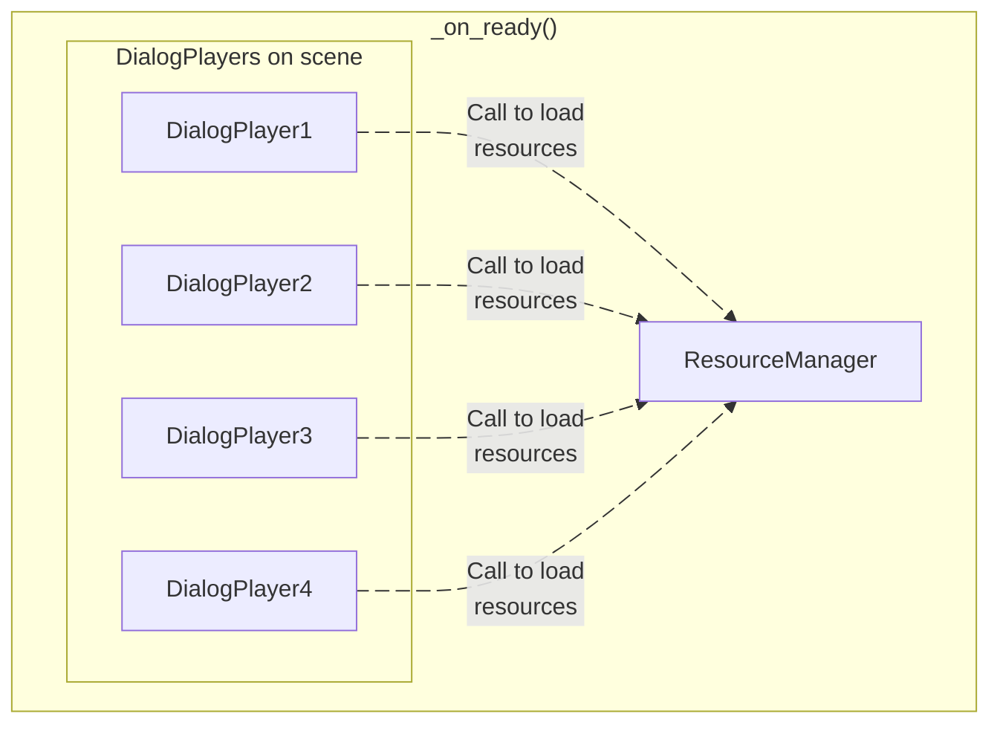
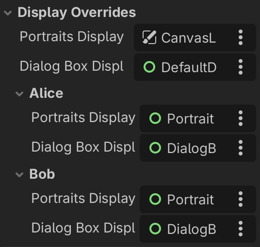
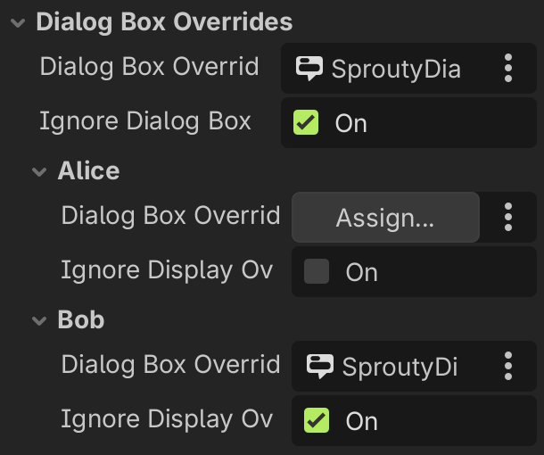

# Using Dialogues

Once you have created a dialogue, you can use it in different ways, as we have already seen in the [create a dialogue](../getting-started/create-a-dialogue) section, but there are more details you should keep in mind.

## How to use a dialogue

---

To use the dialogues from Sprouty Dialogs in your game, as we have already seen in the [create a dialogue](../getting-started/create-a-dialogue#using-dialogues-in-your-game) section, we have the two following options.

### Using dialog players (Recommended)

The recommended way to run your dialogues is using dialog players. To use a [DialogPlayer](../class-reference/nodes/dialog-player.md) node, first you need to **add it to the scene** where you want to run the dialogue.


Then, you must assign the `Dialog Data` or dialogue data file where your dialogue is.


When you select a file, the inspector automatically going to update and now you will see some settings for the [DialogPlayer](../class-reference/nodes/dialog-player.md).

You must choose the **dialogue tree ID of the dialogue you want to play** from the `Start ID` dropdown; otherwise, the player will not know which dialogue tree to run.


Now that you have your dialog player configured, you can call the dialogue from code, using the [play](../class-reference/nodes/dialog-player#play-method)() method _(or [start](../class-reference/nodes/dialog-player#start-method)() on older versions)_ from the [DialogPlayer](../class-reference/nodes/dialog-player.md) node.

For example, we can add a script to the `main` node and add a reference to the [DialogPlayer](../class-reference/nodes/dialog-player.md) that we create before to then call the [play](../class-reference/nodes/dialog-player#play-method)() method where we want in the script.

```gdscript title="main.gd" showLineNumbers
extends Node2D

@onready var dialog_player : DialogPlayer = $DialogPlayer

func _ready() -> void:
	dialog_player.play()

```

In this case, we run the dialog in the [\_ready](https://docs.godotengine.org/en/stable/classes/class_node.html#class-node-private-method-ready)() method of the `main` node or when the scene begins again, so when you run the scene you will see the dialogue.


And that's it! So easy right? 🥳

You can also, create a dialog player node from code and use it in the same way, but you must **first add it to the tree** and **configure the dialogue data file and start ID** before running it.

```gdscript title="main.gd" showLineNumbers
extends Node2D

var dialog_data := load("res://dialogues/my_dialogue.tres")

func _ready() -> void:
	var dialog_player = DialogPlayer.new()
	add_child(dialog_player)

	dialog_player.set_dialog(dialog_data, "FIRST")
	dialog_player.play()

```

:::info[Important]

All the resources needed for the dialog will be loaded at once when the [set_dialog](../class-reference/nodes/dialog-player#set-dialog-method)() method is called, which can cause **slowdowns if large resources need to be loaded**.

For more details see the [about dialogue resources](#about-dialogue-resources) section.

:::

### Using SproutyDialogs autoload

Otherwise, instead of create a DialogPlayer node in the scene, you can play a dialogue using the Sprouty Dialogs Autoload. You can call the [play](../class-reference/core/sprouty-dialogs-manager#play-method)() method _(or [start_dialog](../class-reference/core/sprouty-dialogs-manager#start-dialog-method)() on older versions)_ from the [SproutyDialogs](../class-reference/core/sprouty-dialogs-manager.md) autoload passing the dialogue data resource and the ID of the dialogue tree you want to run.

```gdscript title="main.gd" showLineNumbers
extends Node2D

var dialog_data := load("res://dialogues/my_dialogue.tres")

func _ready() -> void:
	SproutyDialogs.play(dialog_data, "FIRST")

```

And in this way you can also see the dialogue when you run the scene.


:::info[Important]

This method also loads all the resources needed for the dialogue at once when the method is called, so may cause a **slowdown if you have large resources to load**.

For more details see the [about dialogue resources](#about-dialogue-resources) section.

:::

## About dialogue resources

---

When you set a [DialogPlayer](../class-reference/nodes/dialog-player.md) node in a scene to run a dialogue, this node will load all the resources needed (dialog boxes, characters, portraits, etc) on ready, using the [Resource Manager](../class-reference/utils/resource-manager.md) singleton.

The [Resource Manager](../class-reference/utils/resource-manager.md) is going to keep track of the resources required for all the dialogues that will run in the current scene, which means, the resources needed by **all the dialog players in the scene**. The resource manager **ensures that each resource is only loaded once**, even if more than one dialog player uses it.



This way, resources are **loaded only once at the start of the scene** and then **instantiated when needed in a dialog**. Furthermore, they are **destroyed when they are no longer needed**.

For this reason, care must be taken when loading **large resources, such as complex portrait scenes**. If you set the **dialog players from the code or use the Sprouty Dialogs autoload**, the resources will be loaded when you call the [set_dialog](../class-reference/nodes/dialog-player#set-dialog-method)() or [start_dialog](../class-reference/core/sprouty-dialogs-manager#start-dialog-method)() methods.

_If you call these methods during runtime, there will be a **slowdown due to resource loading**. However, if you have set the **DialogPlayer node directly in the scene**, you will **ensure that resources are loaded when the scene starts**._

## Display Overrides

---

You can override the display parents of your dialog boxes and portraits for each character in a dialogue to **change the position of the dialog box or portrait on screen** for a given dialogue, for example, or whatever you want.

This allows more flexibility to display the dialogue components, for example, to use **dialogue bubbles as dialog boxes that follow the position of the NPCs**.

When you assign a dialogue data file that use characters in a [DialogPlayer](../class-reference/nodes/dialog-player.md) node, the inspector will add a new group of properties called `Display Overrides`.



Here you will find **two general properties and a section for each character in the dialogues** of the selected dialog data:

- **Portraits Display Override** and **Dialog Box Display Override**: Set the display parent node **for all the characters** in the dialogue.
- In each character section, you can set the **Portraits Display** and **Dialog Box Display** node fields to set the display parent node **individually for that character**.

> _The per-character overrides take precedence over the general ones. If neither is set, the portraits and dialog boxes are displayed using the **default canvas layers**._

Also, you can set the overrides from code using the [set_portraits_display_override](../class-reference/nodes/dialog-player#set-portraits-display-override-method)() and [set_dialog_box_display_override](../class-reference/nodes/dialog-player#set-dialog-box-display-override-method)() methods of the [DialogPlayer](../class-reference/nodes/dialog-player.md) node. Both methods receive the **parent node** to apply and an optional `character_name` (the character's key name, i.e., its file name). If the character name is provided, the node is set as the display parent **for that character**, and if it is omitted, the node is set as the **general display parent for all the characters**.

```gdscript title="main.gd" showLineNumbers
extends Node2D

func _ready() -> void:
	var dialog_player : DialogPlayer = $DialogPlayer

	# Set the display parents for all the characters
	dialog_player.set_portraits_display_override(get_node("PortraitsParent"))
	dialog_player.set_dialog_box_display_override(get_node("DialogBoxParent"))

	# Set the display parents only for the "sprouty" character,
	# e.g., to display a dialogue bubble that follows the character
	dialog_player.set_portraits_display_override(get_node("BubbleWindow"), "sprouty")
	dialog_player.set_dialog_box_display_override(get_node("BubbleWindow"), "sprouty")

	dialog_player.play()
```

You can also read the current overrides from code using the [get_portraits_display_override](../class-reference/nodes/dialog-player#get-portraits-display-override-method)() and [get_dialog_box_display_override](../class-reference/nodes/dialog-player#get-dialog-box-display-override-method)() methods, which return the display parent node **for the given character**, or the **general display parent node** if no character name is provided (`null` if it is not set).

```gdscript title="main.gd" showLineNumbers=17
func _read_overrides() -> void:
	var portrait_parent : Node = dialog_player.get_portraits_display_override("sprouty")
	var general_dialog_box_parent : Node = dialog_player.get_dialog_box_display_override()
```

:::info[Note]

The `portrait_parents` and `dialog_box_parents` **dictionaries** parameters of the [set_dialog](../class-reference/nodes/dialog-player#set-dialog-method)() method, and of the [play](../class-reference/core/sprouty-dialogs-manager#play-method)() and [start_dialog](../class-reference/core/sprouty-dialogs-manager#start-dialog-method)() methods of the Sprouty Dialogs autoload, are still available for backwards compatibility, and they apply the given nodes as **per-character overrides**.

:::

## Dialog Box Overrides

---

You can also override the dialog box used to display the dialogues, to use a **custom dialog box node** instead of the [default dialog box](../settings#defaults) assigned in the plugin settings, or the dialog boxes assigned in the characters data resources. For example, to use a dialog box with a **custom style** for a specific character.

When you assign a dialogue data file that use characters in a [DialogPlayer](../class-reference/nodes/dialog-player.md) node, the inspector will add a new group of properties called `Dialog Box Overrides`.



Here you will find **two general properties and a section for each character in the dialogues** of the selected dialog data:

- **Dialog Box Override**: Set a custom [DialogBox](../class-reference/nodes/dialog-box.md) node to use for the dialogues **of all the characters**.
- **Ignore Dialog Box Display Override**: If enabled, the custom dialog box node is used **as is**, keeping its current parent node in your scene. _It only applies to the **Dialog Box Override** node, not to the per-character overrides._
- In each character section, you can set the **Dialog Box Override** and **Ignore Display Override** fields to override the dialog box **individually for that character**.

> _Setting a dialog box override for a character **overrides the dialog box assigned in its character data resource**. The general **Dialog Box Override** replaces the **default dialog box** from the settings, which is used when a character has no dialog box assigned or the dialogue has no character._

Also, you can set the overrides from code using the [set_dialog_box_override](../class-reference/nodes/dialog-player#set-dialog-box-override-method)() method of the [DialogPlayer](../class-reference/nodes/dialog-player.md) node, which receives the custom [DialogBox](../class-reference/nodes/dialog-box.md) node, an optional `ignore_display_override` flag, and an optional `character_name` (the character's key name, i.e., its file name). If the character name is provided, the dialog box is set **for that character**, and if it is omitted, it is set as the **general override for all the characters**.

```gdscript title="main.gd" showLineNumbers
extends Node2D

func _ready() -> void:
	var dialog_player : DialogPlayer = $DialogPlayer

	# Set a custom dialog box for all the characters,
	# keeping its current parent in the scene
	dialog_player.set_dialog_box_override(get_node("MyCustomDialogBox"))

	# Set another custom dialog box only for the "sprouty" character
	dialog_player.set_dialog_box_override(get_node("SproutyDialogBox"), false, "sprouty")

	dialog_player.play()
```

You can also read the current overrides from code using the [get_dialog_box_override](../class-reference/nodes/dialog-player#get-dialog-box-override-method)() method, which returns the dialog box node **for the given character**, or the **general dialog box override ** if no character name is provided (`null` if it is not set).

```gdscript title="main.gd" showLineNumbers=15
func _read_overrides() -> void:
	var character_dialog_box : Node = dialog_player.get_dialog_box_override("sprouty")
	var general_dialog_box : Node = dialog_player.get_dialog_box_override()
```

## Using DialogPlayer signals

---

The [DialogPlayer](../class-reference/nodes/dialog-player.md) nodes have some signals that you can use to handle the state of the dialogue. This signals are the following:

```gdscript
## Emitted when the dialog starts.
signal dialog_started()
## Emitted when the dialog is paused.
signal dialog_paused()
## Emitted when the dialog is resumed.
signal dialog_resumed()
## Emitted when the dialog is ended.
signal dialog_ended()
```

Also, there are two special signals:

```gdscript
## Emitted when a dialog option is selected.
signal option_selected(option_index: int, option_dialog: Dictionary)
## Emitted when a signal event is emitted.
signal signal_event(signal_id: String, args: Array)
```

First, the `option_selected` signal is emitted when an **option is selected in the dialogue** and returns the option index and a dictionary with the dialogue and translations of the selected option in the following format:

```
{
	"en" : "This is the option in Engligh"
	"es" :" Esta es la opción en Español"
}
```

For the other hand, the `signal_event` signal is emitted when a [Signal Node](./event-nodes#signal-node) is trigger in the dialogue tree. This signal returns the argument that you give to the event node to do wharever you need with it.

You can also handle the **same signals from the Sprouty Dialogs autoload**.

```gdscript title="main.gd" showLineNumbers
extends Node2D

var dialog_data := load("res://dialogues/example.tres")

func _ready() -> void:
	SproutyDialogs.dialog_ended.connect(_on_dialog_ended)
	SproutyDialogs.start_dialog(dialog_data, "EXAMPLE")

func _on_dialog_ended() -> void:
	SproutyDialogs.dialog_ended.disconnect(_on_dialog_ended)
	print("The dialogue has ended!")

```
